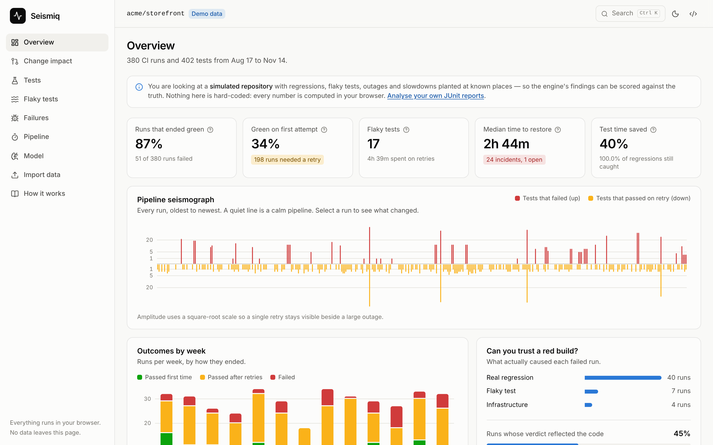
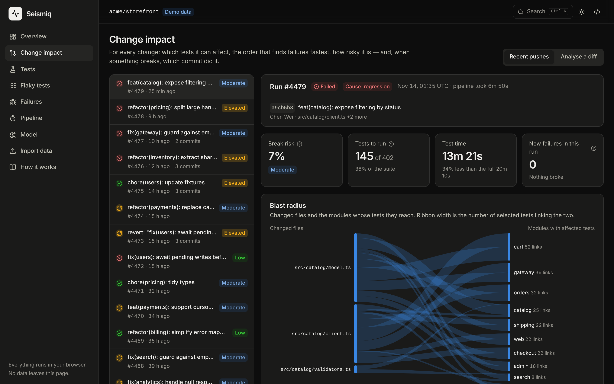
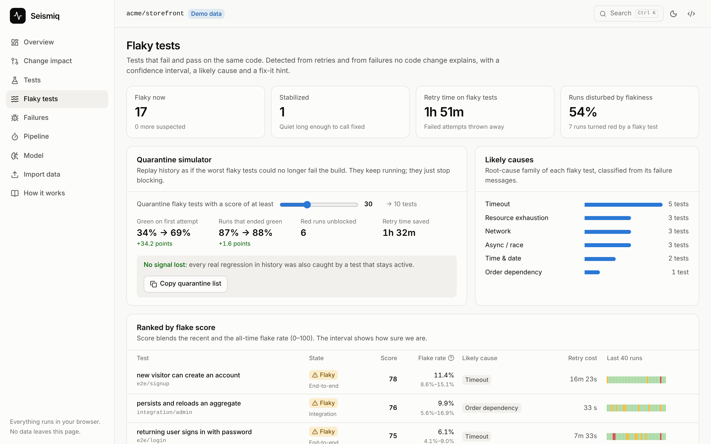

# Seismiq

**Change-aware test intelligence and CI reliability — running entirely in your browser.**

Seismiq reads a project's CI history and answers the questions every engineering team argues about:

- _Which tests does this pull request actually need to run — and in what order?_
- _Is this red build a real regression, a flaky test, or broken infrastructure?_
- _Which of the five commits in that push broke the build?_
- _Which tests are flaky, why, and what does quarantining them cost?_
- _Which tests got slower, and how should the suite be split across parallel jobs?_

**Live demo:** https://chaaruviswas.github.io/seismiq/



There is no backend. The analysis engine is plain TypeScript that runs in a Web Worker in the browser, or in Node as a CLI inside your CI. Your test reports never leave your machine.

---

## Results

The demo is a simulated monorepo with regressions, flaky tests, outages and slowdowns planted at known places. The simulator records what it planted; the engine never sees it. That makes every claim below a measurement, not a promise.

Reproduce with `npm run benchmark` — 30 independently simulated repositories (≈400 tests, 380 CI runs each):

| Metric (30 simulated repositories)                         | Mean   | Worst  |
| ---------------------------------------------------------- | ------ | ------ |
| Flaky-test precision                                       | 100.0% | 100.0% |
| Flaky-test recall                                          | 97.8%  | 86.7%  |
| Flaky root cause named correctly                           | 99.1%  | 84.6%  |
| Culprit commit ranked first                                | 97.2%  | 91.3%  |
| …when the push contained 2+ commits                        | 96.0%  | 88.2%  |
| Regression failures that change-aware selection still runs | 99.6%  | 97.6%  |
| Test time saved by change-aware selection                  | 39.5%  | 32.1%  |
| Slowdowns located                                          | 99.5%  | 85.7%  |
| Infrastructure incidents recognised                        | 100.0% | 100.0% |
| Held-out ROC AUC of the failure model                      | 0.928  | 0.867  |
| APFD — ordered by predicted risk                           | 0.905  | 0.751  |
| APFD — default order                                       | 0.314  | —      |
| New failures found in the riskiest 20% of tests            | 85.8%  | 60.0%  |
| Full analysis time per repository                          | 244 ms | 408 ms |

APFD (Average Percentage of Faults Detected) is the standard metric for test prioritisation: 1.0 means every failure surfaces immediately.

---

## Features

### Change impact

- **Test selection** from four independent signals: direct imports, the transitive import graph, recorded per-test coverage, and couplings _learned from history_ that static analysis cannot see.
- **Safety rules:** manifests, lockfiles, build and CI configuration force a full run; documentation-only changes run nothing; tests already failing always re-run.
- **Risk-ordered test plan:** every selected test gets a predicted failure probability, and the run order finds failures several times faster than the default order.
- **Explainable predictions:** each prediction splits exactly into per-signal contributions, shown as a diverging bar chart under every test.
- **Calibrated break risk** for the whole change.
- **Blast-radius diagram** linking changed files to the modules whose tests they reach.
- **Paste any diff** — unified diff, `git diff --numstat`, `--name-status`, or a list of paths — and get a test plan.

### Reliability

- **Culprit ranking:** when a push with several commits breaks tests, each commit is scored by stack-trace mentions, imports, coverage and graph distance, with the evidence listed. The fixing commit is identified too.
- **Flaky-test detection** from retries _and_ from isolated failures no change explains, with a 95% Wilson confidence interval, a 0–100 score, and automatic _stabilized_ detection when a quiet streak is unlikely to be luck.
- **Root-cause classification** (timeout, network, async race, order dependency, time & date, resource exhaustion, infrastructure) with a concrete fix-it hint.
- **Quarantine simulator:** replay history as if the worst flaky tests could no longer block the build — see the gain _and_ the regressions you would have missed.
- **Failure clustering:** thousands of messages normalised (ids, numbers, addresses, line numbers stripped) and merged by TF-IDF similarity into a few distinct problems.
- **Infrastructure-incident detection**, so outages do not pollute flakiness statistics or blame a commit.
- **DORA-style health:** pass rate, first-attempt pass rate, change-failure rate, median time to restore, and a "can you trust a red build?" breakdown.

### Speed

- **Slowdown detection** by change-point analysis on log durations, linked to the commits that touched code the test reaches.
- **Shard planner** that balances parallel CI jobs by measured duration (longest-first, within 4/3 of optimal) against the usual count-based split.
- **Pipeline trends:** wall-clock duration and time lost to retries per week.

### Model card

Held-out ROC curve, recall at each budget, APFD against the default order, time to first failure, a calibration table, and the learned weights. Trained on the oldest 70% of runs, scored on the newest 30% — never a random split. A unit test proves no feature uses the future.

### Product

- Pipeline **seismograph** of every run, weekly outcome charts, per-test history heat strips and duration charts — all hand-written SVG with hover readouts.
- **Import your own JUnit XML** (Vitest, Jest, Playwright, pytest, Maven/Gradle Surefire, Go): drag and drop, analysed locally, kept in IndexedDB between visits. Both retry styles are understood.
- **Command palette** (Ctrl/⌘ K) over tests, runs, commits and pages.
- Light and dark themes, responsive down to phone width, keyboard accessible, colour never the only channel.

| Change impact                            | Flaky tests                    |
| ---------------------------------------- | ------------------------------ |
|  |  |

---

## In your CI

`npm run build:cli` produces `dist-cli/seismiq.mjs`, a single dependency-free file for Node 20+.

```bash
# Run only the test files a pull request can affect
npx vitest run $(node dist-cli/seismiq.mjs select --base origin/main)
```

```bash
# Explain the selection in the job summary or a PR comment
node dist-cli/seismiq.mjs select --base origin/main --format md >> "$GITHUB_STEP_SUMMARY"
```

```bash
# Reliability report from a folder of JUnit XML files
node dist-cli/seismiq.mjs report reports/ --out "$GITHUB_STEP_SUMMARY"
```

`select` builds the import graph of a JavaScript/TypeScript project (ESM, CommonJS, dynamic imports, re-exports, `.js`→`.ts` resolution, index files), diffs against the merge base, and handles global files and docs-only changes. `--format json` is available for bots. This repository's own CI uses both commands.

---

## Architecture

```
src/
  engine/            Pure TypeScript, no DOM — runs in the browser worker and in Node
    simulator.ts     Deterministic CI-history generator with recorded ground truth
    repo.ts          Import graph, reachability, change sets, test selection
    history.ts       Rolling per-test / per-file history and the 12 model features
    model.ts         Logistic regression (Newton / IRLS), explanations
    analyze.ts       One chronological pass: selection, features, training, metrics
    flaky.ts         Flake events, Wilson intervals, incidents, culprit ranking
    clusters.ts      Message fingerprints, TF-IDF clustering, infra detection
    durations.ts     Change-point slowdown detection, shard planning
    quarantine.ts    What-if replay
    junit.ts         JUnit XML import and export
    diff.ts          Unified diff / numstat / name-status parsing
    importGraph.ts   Static import extraction and resolution for the CLI
    evaluate.ts      Scores the engine against the simulator's ground truth
  worker/            Web Worker wrapper — the UI thread never blocks
  pages/, components/  React UI, hand-written SVG charts
cli/seismiq.ts       The CLI
tests/               Vitest unit and integration tests
e2e/                 Playwright tests (desktop and phone)
```

**Stack:** React 19, TypeScript 7 (strict), Vite 8, Tailwind CSS 4, Zustand, React Router, Web Workers, IndexedDB, fast-xml-parser, Lucide icons, Vitest 5, Playwright, Biome, esbuild, GitHub Actions, GitHub Pages. Machine learning, statistics, clustering and charts are implemented from scratch — no ML or chart library.

### Design decisions

- **A linear model on purpose.** Twelve features, a few hundred positive examples per project: a regularised logistic regression is accurate here, trains in milliseconds in the browser, and decomposes exactly into per-feature contributions — explainability users can check.
- **Predict _new_ failures.** A test that is already failing needs no prediction; it always runs first. Training on all failures would just learn "it failed last time".
- **Calibrated risk, not a product of probabilities.** One bug breaks many tests at once, so per-test probabilities are not independent. Run-level risk passes the expected number of new failures through a second fitted model.
- **Time-ordered evaluation.** Features for run _r_ use only runs before _r_; a test asserts that analysing a prefix of history gives bit-identical features.
- **Infrastructure runs prove nothing** about the commits they built, so those commits are carried into the next run and judged there.

---

## Development

```bash
npm install
npm run dev          # http://localhost:5173
npm run check        # typecheck, lint, unit tests, build, CLI build
npm run test:e2e     # Playwright, desktop and phone
npm run benchmark    # engine accuracy over 30 simulated repositories
```

Deployment is automatic: every push to `main` runs the tests and publishes `dist/` to GitHub Pages (`.github/workflows/deploy.yml`). The build uses relative asset paths and hash routing, so it works on any static host.

## License

MIT
